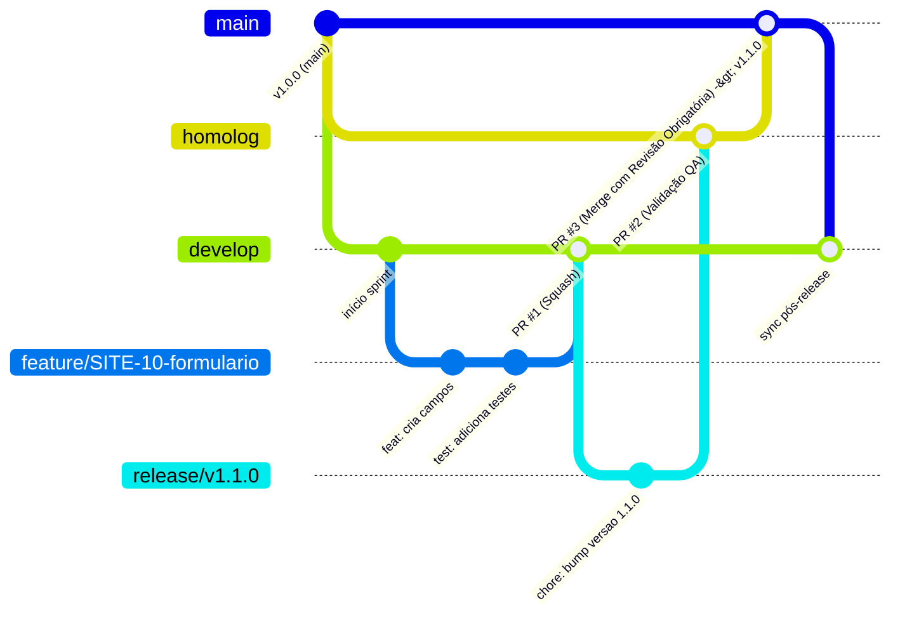

# 🌿 Guia de Fluxo Git, Nomenclatura e Políticas de Pull Request
**Devs From Tomorrow (DFT)**

Este documento estabelece a governança de versionamento de código, ciclo de vida de branches, convenções de nomenclatura e diretrizes estritas para Pull Requests e Code Review no repositório.

---

## 📌 1. Visão Geral dos Ambientes e Branches Principais

O projeto adota um fluxo estruturado baseado no **Git Flow adaptado**, dividindo as responsabilidades de desenvolvimento, validação e entrega contínua em três ambientes e branches perenes:

```
┌──────────────┐     ┌──────────────┐     ┌──────────────┐
│  DESENVOLV.  │ ──> │ HOMOLOGAÇÃO  │ ──> │   PRODUÇÃO   │
│  (develop)   │     │  (homolog)   │     │    (main)    │
└──────────────┘     └──────────────┘     └──────────────┘
```

| Branch | Ambiente correspondente | Propósito | Proteção e Políticas |
| :--- | :--- | :--- | :--- |
| **`main`** | **Produção** | Código estável, testado e publicado para os usuários finais. Toda alteração reflete o estado atual em produção. | 🔒 **Protegida**. Push direto bloqueado. Exige Pull Request, revisão formal aprovada e testes passando. Cada merge gera uma tag de versão (`vX.Y.Z`). |
| **`homolog`** | **Homologação / Staging** | Ambiente idêntico à produção para validação de QA, testes de aceitação de clientes e validação com dados reais/sandbox. | 🔒 **Protegida**. Push direto bloqueado. Merges originados de `release/*` ou `develop` via PR aprovado. |
| **`develop`** | **Desenvolvimento** | Branch de integração contínua do dia a dia. Reúne novas features e melhorias concluídas pela equipe. | 🔒 **Protegida**. Push direto bloqueado. Recebe merges de branches `feature/*` e `bugfix/*` via PR. |

---

## 🌳 2. Branches Temporárias de Trabalho

Para o desenvolvimento diário, desenvolvedores nunca devem commitar diretamente em `develop`, `homolog` ou `main`. Sempre crie uma branch temporária dedicada:

| Tipo | Origem (Base) | Destino do Merge | Descrição / Uso |
| :--- | :--- | :--- | :--- |
| **`feature/*`** | `develop` | `develop` | Desenvolvimento de novas funcionalidades ou módulos. |
| **`bugfix/*`** | `develop` ou `homolog` | `develop` (ou `homolog` com sync) | Correção de defeitos identificados durante testes ou homologação. |
| **`hotfix/*`** | `main` | `main`, `homolog` e `develop` | Correção emergencial de bug crítico em ambiente de produção. |
| **`release/*`** | `develop` | `homolog` e depois `main` | Preparação, estabilização e congelamento para entrega de uma nova versão. |
| **`chore/*`** ou **`refactor/*`** | `develop` | `develop` | Atualizações de dependências, refatorações internas ou melhorias de build/CI. |

---

## 🔄 3. Diagramas de Fluxo

### 3.1 Fluxo Padrão: Nova Feature até Produção



### 3.2 Fluxo de Hotfix Crítico em Produção

```mermaid
gitGraph
    commit id: "v1.1.0 (main)"
    branch hotfix/SITE-99-falha-envio
    checkout hotfix/SITE-99-falha-envio
    commit id: "fix: corrige envio SMTP"
    checkout main
    merge hotfix/SITE-99-falha-envio id: "PR Emergencial (Revisão Obrigatória) -> v1.1.1"
    branch homolog
    checkout homolog
    merge main id: "sync hotfix homolog"
    branch develop
    checkout develop
    merge main id: "sync hotfix develop"
```

---

## 🏷️ 4. Convenção de Nomenclatura

Para garantir rastreabilidade com tarefas, tickets e facilidade de busca no repositório, adote as seguintes regras:

### 4.1 Formato das Branches

```
<tipo>/<código-tarefa>-<descrição-curta-em-kebab-case>
```

> **Nota de compatibilidade:** O projeto aceita tanto prefixos em minúsculas (`feature/`, `bugfix/`) quanto maiúsculas (`FEATURE/`, `BUGFIX/`), priorizando o padrão kebab-case descritivo com o ID da tarefa.

#### Exemplos Válidos:
* `feature/SITE-12-painel-orcamentos`
* `FEATURE/SITE-08-otimizacao-hero-admin`
* `bugfix/SITE-14-responsividade-tabela-ctas`
* `hotfix/SITE-22-correcao-bloqueio-cors-api`
* `release/v1.2.0`
* `chore/SITE-03-atualizacao-deps-vite-react`

#### Exemplos Inválidos (Evitar):
* ❌ `novo-painel` *(falta o tipo e código da tarefa)*
* ❌ `feature/arrumar coisas no site` *(contém espaços)*
* ❌ `teste_branch` *(não descritivo, uso de snake_case sem contexto)*
* ❌ `fix-bug` *(falta o prefixo e identificador)*

---

### 4.2 Padrão de Mensagens de Commit (Conventional Commits)

Os commits devem seguir o padrão [Conventional Commits](https://www.conventionalcommits.org/):

```
<tipo>(<escopo opcional>): <descrição no imperativo e em minúsculas>
```

| Tipo | Quando utilizar | Exemplo |
| :--- | :--- | :--- |
| **`feat`** | Nova funcionalidade para o usuário | `feat: adiciona filtro por status no painel de projetos` |
| **`fix`** | Correção de bug | `fix: corrige offset negativo no gráfico de leads` |
| **`docs`** | Alteração em documentações ou README | `docs: documenta fluxo de branches e política de PR` |
| **`refactor`** | Mudança no código que não altera comportamento | `refactor: simplifica serviço de submissão do formulário` |
| **`perf`** | Melhoria de desempenho | `perf: otimiza renderização do background interativo com canvas` |
| **`test`** | Adição ou ajuste de testes | `test: adiciona testes unitários para a rota api/contact` |
| **`chore`** | Tarefas de build, configs ou ferramentas auxiliares | `chore: atualiza dependências do composer` |

---

## 🛡️ 5. Política de Pull Requests (PRs) e Revisão de Código

### ⚠️ Regra Mandatória: Merge na Branch Principal (`main`) Exige Revisão

Para proteger a integridade da aplicação em produção:
1. **Push direto na branch `main` é estritamente proibido.**
2. **Nenhuma alteração pode ser mesclada na `main` sem um Pull Request formal.**
3. **Todo Pull Request para `main` (e para `homolog`) exige no mínimo 1 (uma) aprovação de Code Reviewer.**
4. O autor do PR **não pode** aprovar o seu próprio Pull Request.

---

### 5.1 Critérios de Aceite para Aprovação de um Pull Request

Antes de aprovar e realizar o merge, o revisor e o autor devem validar os seguintes pontos:

- [ ] **Descrição Clara:** O PR preenche todos os campos do template (`.github/pull_request_template.md`), com contexto do problema e da solução.
- [ ] **Rastreabilidade:** O título do PR faz referência ao card/tarefa correspondente (ex: `[SITE-12] Implementa painel de orçamentos`).
- [ ] **Testes Automatizados:** Suíte de testes do PHPUnit executada e passando com sucesso (`composer run test`).
- [ ] **Análise Estática / Lint:** Verificação de lint do frontend sem erros impeditivos (`npm run lint`).
- [ ] **Build de Produção:** Build de assets compilado e validado (`npm run build`).
- [ ] **Branch Atualizada:** A branch está atualizada com a branch de destino (`up-to-date`), sem conflitos de merge.
- [ ] **Revisão de Segurança & Boas Práticas:**
  - Sem credenciais, senhas ou tokens expostos em commits.
  - Validações de entrada de dados implementadas (ex: Form Requests no Laravel).
  - Componentes React tipados e sem vazamento de estado.

---

### 5.2 Estratégias de Merge Recomendadas

| Rota do Merge | Estratégia no GitHub | Motivo |
| :--- | :--- | :--- |
| `feature/*` ➔ `develop` | **Squash and Merge** | Condensa os commits intermediários de desenvolvimento em um commit único, limpo e atômico no histórico de `develop`. |
| `develop` / `release/*` ➔ `homolog` | **Create a Merge Commit** | Preserva o histórico de integração e commits da release para auditoria de QA. |
| `homolog` / `release/*` ➔ `main` | **Create a Merge Commit** | Mantém marcos claros de versão para auditoria, rollback e geração de tags (`git tag -a vX.Y.Z`). |
| `hotfix/*` ➔ `main` | **Squash and Merge** ou **Merge Commit** | Registra pontualmente a correção aplicada na versão de produção. |

---

## ⚙️ 6. Configuração no GitHub (Branch Protection Rules)

Para configurar e aplicar essas políticas no repositório GitHub:

1. Acesse o repositório no GitHub: `Settings` ➔ `Branches` (ou `Rules` ➔ `Rulesets`).
2. Clique em **Add rule** (ou **Add branch ruleset**) e configure o padrão de branch para `main`:
   - **Branch name pattern:** `main`
3. Ative obrigatoriamente as opções:
   - ✅ **Require a pull request before merging**
     - Sub-opção: **Require approvals:** Selecione `1` (ou mais).
     - Sub-opção: **Dismiss stale pull request approvals when new commits are pushed** (invalida aprovação se novos commits forem adicionados).
     - Sub-opção: **Require review from Code Owners** (se houver `CODEOWNERS`).
   - ✅ **Require status checks to pass before merging** (CI/testes automatizados).
     - Sub-opção: **Require branches to be up to date before merging**.
   - ✅ **Block force pushes** (impede `git push --force`).
   - ✅ **Do not allow deletions** (impede que a branch principal seja deletada).
   - ✅ **Do not allow bypassing the above settings** (aplica as regras inclusive para administradores).
4. *(Recomendado)* Repita o mesmo procedimento para a branch `homolog` e `develop`.

---

## 🚀 7. Passo a Passo Rápido para o Desenvolvedor

### Criando uma nova funcionalidade:
```bash
# 1. Garanta que a branch develop está atualizada
git checkout develop
git pull origin develop

# 2. Crie sua branch a partir de develop
git checkout -b feature/SITE-15-minha-funcionalidade

# 3. Desenvolva e faça commits atômicos
git add .
git commit -m "feat: implementa componente de listagem de mensagens"

# 4. Envie para o repositório remoto
git push -u origin feature/SITE-15-minha-funcionalidade

# 5. Abra o Pull Request no GitHub apontando para a branch 'develop'
# 6. Solicite a revisão de um colega da equipe
```

### Criando um Hotfix emergencial:
```bash
# 1. Atualize a branch main
git checkout main
git pull origin main

# 2. Crie a branch de hotfix
git checkout -b hotfix/SITE-99-falha-critica

# 3. Aplique a correção
git commit -m "fix: corrige validação de e-mail no formulário"
git push -u origin hotfix/SITE-99-falha-critica

# 4. Abra o Pull Request para 'main'
# 5. Obtenha aprovação obrigatória do Tech Lead / Revisor
# 6. Após merge na main, propague a correção para 'homolog' e 'develop'
```

